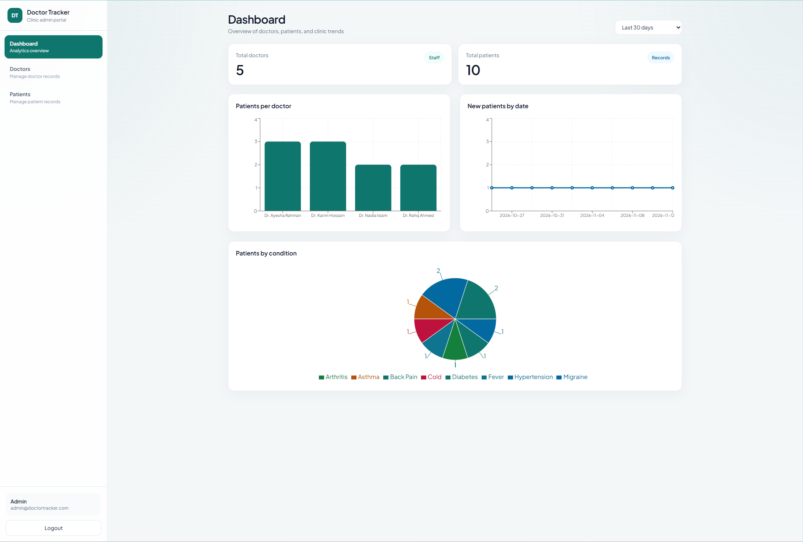
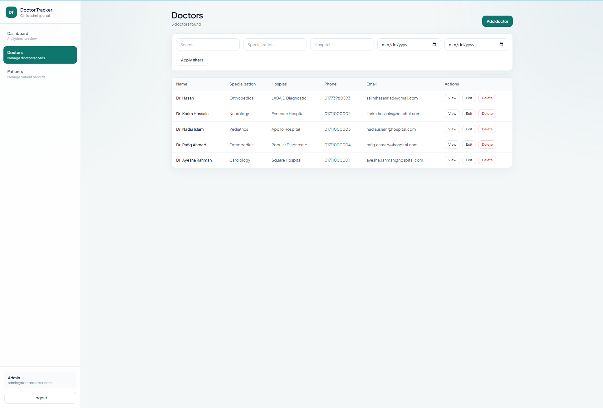
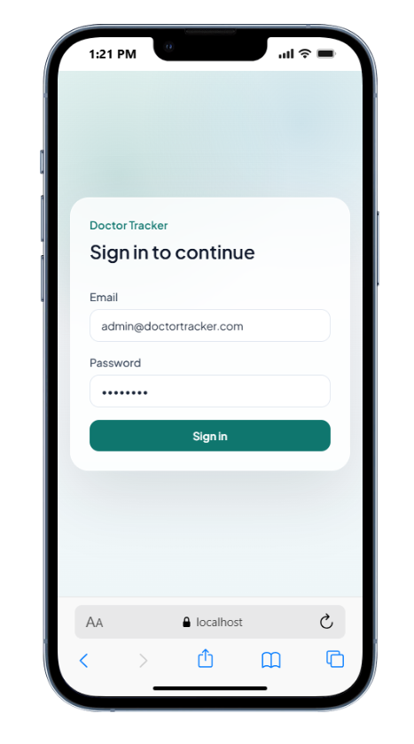
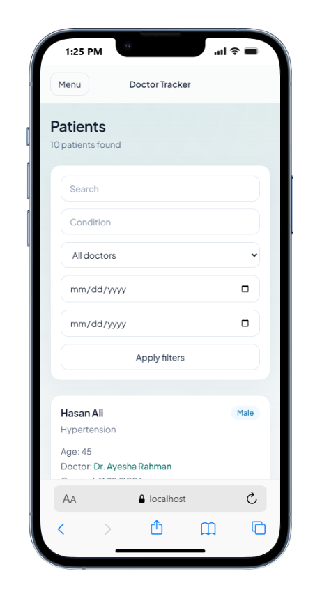

# Doctor Tracker Client

## Description

Doctor Tracker is a secure admin web app for managing doctors and their patients. It gives clinic staff one place to search records, filter lists, and review simple analytics without juggling spreadsheets.

## Setup Guide

### Requirements

- Node.js 18+
- Running Doctor Tracker API (`doctor-tracker-api`)

### Steps

1. Clone the repository

```bash
git clone https://github.com/Salim66/doctor-tracker-client.git
cd doctor-tracker-client
```

2. Install dependencies

```bash
npm install
```

3. Create env file

```bash
cp .env.example .env.local
```

Set the API URL:

```env
NEXT_PUBLIC_API_URL=http://localhost:5000/api
```

4. Start the app

```bash
npm run dev
```

Open [http://localhost:3000](http://localhost:3000)

### Demo login

Use the seeded API admin account:

- Email: `admin@doctortracker.com`
- Password: `admin123`

### .env.example

```env
NEXT_PUBLIC_API_URL=http://localhost:5000/api
```

## System Architecture

```text
Browser
  -> Next.js App Router pages
  -> Axios API helper (JWT from localStorage)
  -> Express REST API
  -> MongoDB
```

Pages:

- `/login` — authentication
- `/dashboard` — totals and charts
- `/doctors` — doctor list, create, filters
- `/doctors/[id]` — doctor detail and patients under that doctor
- `/patients` — all patients with edit/delete/filters

Protected routes check for a stored token before rendering dashboard pages.

## Technical Decisions

### 1. Axios + localStorage for auth state

The backend uses Bearer JWT. Storing the token in localStorage and attaching it through an Axios interceptor keeps the client simple and works well with a separately hosted API.

### 2. Recharts for dashboard visualization

The PDF asks for visual analytics. Recharts is lightweight and fits the required charts (patients per doctor and date-based stats) without pulling in a heavier charting stack.

## Visual Evidence

Place screenshots in `public/screenshots/` before submission:

- `desktop-dashboard.png`
- `desktop-doctors.png`
- `mobile-login.png`
- `mobile-patients.png`

Then reference them here:

```md




```

## Scripts

```bash
npm run dev
npm run build
npm run start
```
